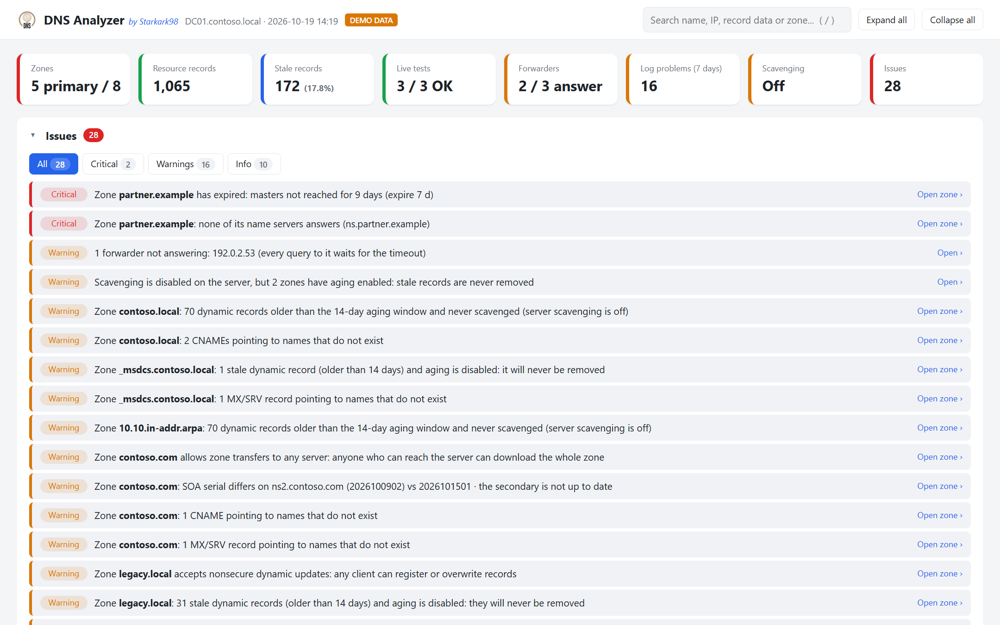
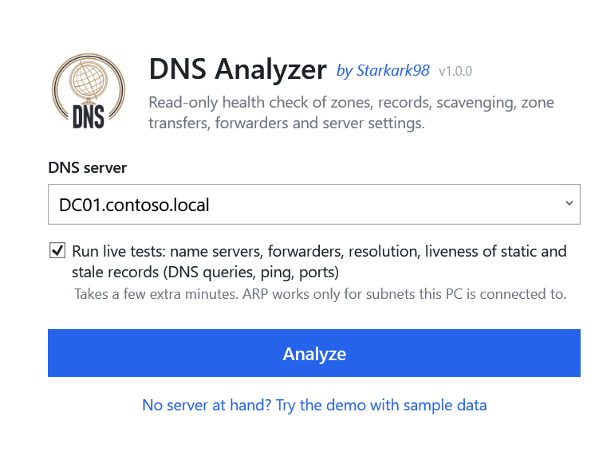
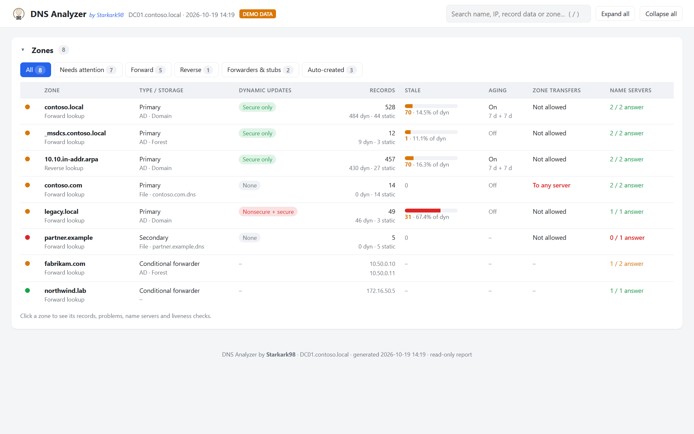
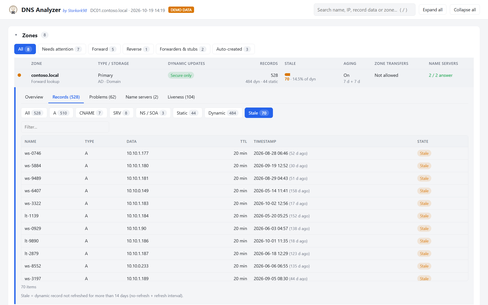
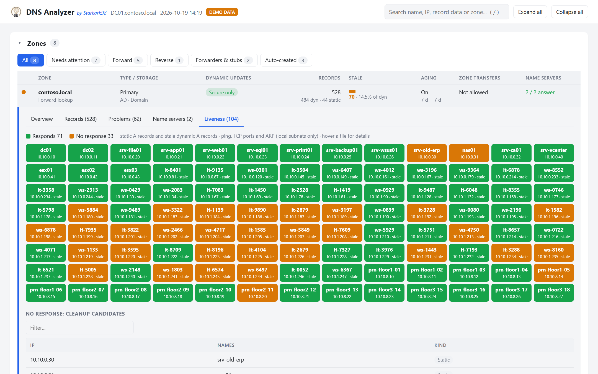
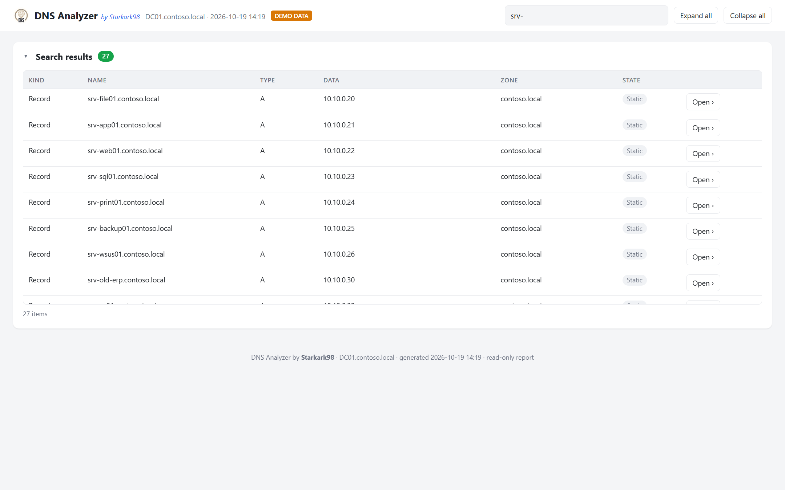
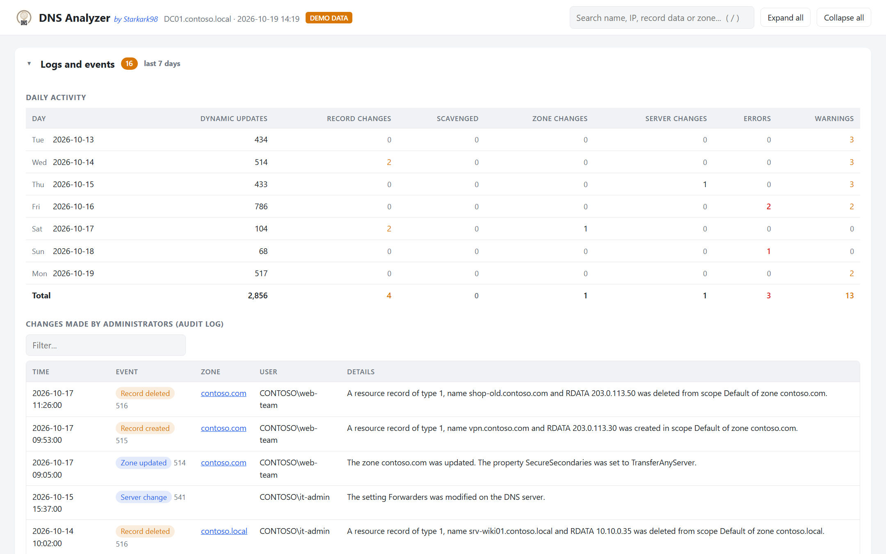
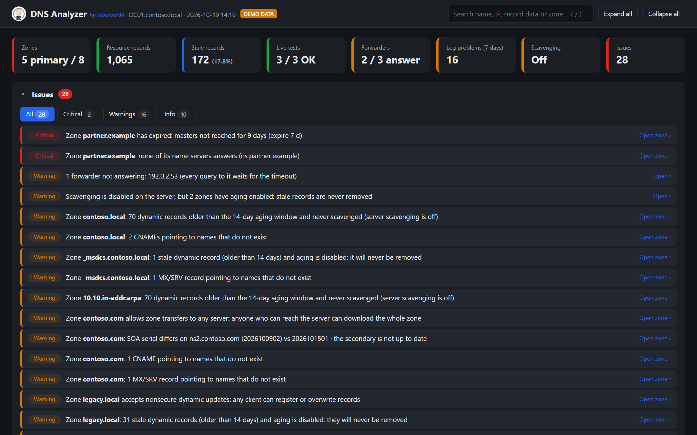

<p align="center">
  <picture>
    <source media="(prefers-color-scheme: dark)" srcset="docs/logo/logo-on-dark.png">
    
  </picture>
</p>

# DNS Analyzer *by Starkark98*


-16a34a)

[](https://ko-fi.com/starkark98)

**A free, read-only health check for Windows DNS servers — with an interactive dashboard you can understand at a glance.**

One PowerShell file, nothing to install on the server, no agents, no database. Point it at a DNS server and in a few minutes you know which zones are unhealthy, how many stale records are piling up, whether scavenging actually works, whether forwarders and name servers answer, which records point nowhere, and what changed in the last 7 days.



> **Want to see it first?** Download the ZIP from **Releases**, extract it and double-click **`Start Demo.cmd`**: the dashboard opens with realistic sample data. No DNS server needed.

DNS Analyzer is the companion of [DHCP Analyzer](https://github.com/Starkark98/DhcpAnalyzer): same idea, same look, same read-only approach.

---

## Contents

- [Why DNS Analyzer](#why-dns-analyzer)
- [Features](#features)
- [Requirements](#requirements)
- [Quick start](#quick-start)
- [Guided tour of the dashboard](#guided-tour-of-the-dashboard)
- [What the issues mean](#what-the-issues-mean)
- [Command line](#command-line)
- [Scheduled reports](#scheduled-reports)
- [How it works](#how-it-works)
- [Security and privacy](#security-and-privacy)
- [Responsible use](#responsible-use)
- [Limitations](#limitations)
- [Troubleshooting](#troubleshooting)
- [FAQ](#faq)
- [Getting help](#getting-help)
- [Support the project](#support-the-project)
- [Contributing](#contributing)
- [Project structure](#project-structure)
- [Maintainer](#maintainer)
- [Built with AI assistance](#built-with-ai-assistance)
- [Disclaimer](#disclaimer)
- [Trademarks](#trademarks)
- [License](#license)

---

## Why DNS Analyzer

The DNS Manager console shows you one zone at a time and never tells you what is wrong. Most DNS problems in Windows networks are slow and silent: scavenging that was never enabled, thousands of stale records, a forwarder that stopped answering, a secondary zone that expired weeks ago, a CNAME pointing to a server that no longer exists.

DNS Analyzer reads the whole server, cross-checks the zones against each other, optionally tests what really answers on the network, and tells you **what needs your attention**, in plain language, with every detail one click away.

## Features

- **Whole-server analysis** in one click: every zone (primary, secondary, stub, conditional forwarder, reverse), every resource record, aging and scavenging, zone transfers, forwarders, root hints and key server settings.
- **Stale record detection**: dynamic records older than the zone's aging window (or 14 days when aging is off), with the classic misconfigurations flagged: aging on but server scavenging off, scavenging on but no zone with aging, scavenging that never ran.
- **Cross-zone consistency checks**: CNAME, MX, SRV and NS records pointing to names that do not exist, A records without a PTR, PTR records pointing to the wrong name, several names sharing the same IP (often a stale record), private subnets without a reverse zone.
- **Live tests** (optional): recursion and authoritative answers of the server, domain controller locator records, every forwarder and conditional forwarder, every name server of every zone (does it answer? same SOA serial?), and a **liveness check of static and stale A records** (ping, common TCP ports, ARP) to find records pointing to hosts that are gone.
- **Security checks**: nonsecure dynamic updates, zone transfers to any server, a server-level plugin DLL (a known privilege-escalation technique), cache pollution protection, global query block list.
- **Logs and events of the last 7 days**: daily activity from the DNS audit log (dynamic updates, manual record changes, zone and server changes, scavenging), **who changed what**, and DNS Server errors and warnings from the event log, grouped, counted and explained.
- **Server statistics** since the service started: queries, NXDOMAIN, SERVFAIL, recursion failures, dynamic updates, zone transfers.
- **Prioritized issues** (critical, warning, info), each linked to the affected zone and tab.
- **Global search** by name, IP address, record data or zone, across all zones.
- **Collapsible sections**, sortable and filterable tables, automatic light/dark theme, print-friendly layout.
- **Self-contained HTML report**: one offline file you can save, archive or send to a colleague.
- **Read-only**: it never changes anything on your DNS server.

## Requirements

| What | Details |
|---|---|
| PC running the tool | Windows 10/11 or Windows Server 2016 and later, with **Windows PowerShell 5.1** (built in). PowerShell 7 is not supported |
| PowerShell module | **DNS Server Tools** (RSAT), see below. Not needed for the demo |
| Browser | Microsoft Edge, Google Chrome or Firefox. Internet Explorer is **not** supported |
| DNS server | Windows Server 2012 R2 or later with the DNS Server role |
| Network | **WinRM** (TCP 5985) towards the DNS server: the DnsServer cmdlets use it. It is enabled by default on Windows Server 2012 and later |
| Permissions | Membership in **DnsAdmins** or local **Administrators** on the DNS server (on a domain controller: Domain Admins, or DnsAdmins). Reading the DNS configuration remotely requires these rights |

**Permissions for the logs section** (optional: if they are missing, the rest of the report still works and the dashboard tells you what could not be read):

- **Event logs** (`DNS Server` and `Microsoft-Windows-DNSServer/Audit`): membership in **Event Log Readers** (or local administrators) on the DNS server, and the firewall rule group **Remote Event Log Management** enabled on the server. The audit channel exists on Windows Server 2016 and later (2012 R2 with update KB2956577).

Install the RSAT DNS tools on Windows 10/11 (run PowerShell as administrator):

```powershell
Add-WindowsCapability -Online -Name Rsat.Dns.Tools~~~~0.0.1.0
```

On Windows Server:

```powershell
Install-WindowsFeature RSAT-DNS-Server
```

> **Tip:** run DNS Analyzer from your admin workstation rather than on a domain controller. You get a modern browser for the dashboard and you avoid running interactive tools on a DC.

## Quick start

1. **Download** the ZIP of the latest version from the **Releases** section of this repository and extract it to any folder. If you want, compare its SHA-256 hash with the one published in the release notes (`Get-FileHash .\DnsAnalyzer-v1.0.0.zip`).
2. **Unblock** the files. Windows marks downloaded files as untrusted; run this once in PowerShell, in the extracted folder:
   ```powershell
   Get-ChildItem -Recurse | Unblock-File
   ```
3. **Double-click `Start DnsAnalyzer.cmd`.** Accept the administrator prompt (UAC), or decline it if your account already has the required rights.
4. **Choose the DNS server.** The domain controllers of your domain and the DNS servers configured on your PC are listed in the drop-down; you can also type a name or an IP address.
5. Leave **"Run live tests"** ticked if you want the name server, forwarder and liveness checks (read [Responsible use](#responsible-use) first), then click **Analyze**.
6. When the analysis is complete the dashboard opens in your browser. Use **Save as...** to keep a copy.



> **Tip: a desktop shortcut with the logo.** `.cmd` files cannot carry an icon, but a shortcut can. Right-click `Start DnsAnalyzer.cmd` → *Show more options* → *Create shortcut*, move the shortcut to your desktop, then *Properties* → *Change Icon...* → *Browse* and pick `docs\logo\DnsAnalyzer.ico`.

## Guided tour of the dashboard

### 1. The summary bar

Eight key indicators: zones, resource records, stale records, live tests, forwarders, log problems in the last 7 days, scavenging and number of issues. The colored edge tells you immediately whether something is wrong (green fine, amber warning, red critical, blue information). **Click any card** to jump to the related section.

### 2. Issues

Everything that deserves your attention, sorted by severity, in plain language. Use the chips to show only critical items, warnings or info. **Click an issue** to open the zone and the exact tab it refers to (for example the list of stale records, or the name server check).

### 3. Zones



One row per zone. The dot on the left is the zone's worst issue (green means no issues). The columns show type and storage (Active Directory replication scope or zone file), dynamic updates, number of records (dynamic and static), stale records with a bar relative to the dynamic ones, aging, zone transfer policy and the result of the name server check. Use the chips to show only zones that need attention, forward or reverse zones, conditional forwarders and stubs, or the auto-created zones (hidden by default).

### 4. Zone details

**Click a zone row** to expand it. The tabs show:

- **Overview**: type, storage, dynamic updates, aging and scavenging window, zone transfers, masters and last transfer (secondary zones), SOA record and number of records by type.
- **Records**: every record, filterable by type (*A*, *AAAA*, *CNAME*, *PTR*, *MX*, *SRV*, *NS / SOA*, *TXT*) and by state (*Static*, *Dynamic*, *Stale*). Click a column header to sort, use the filter box to narrow the list.
- **Problems**: what the cross-zone checks found in this zone (dangling CNAMEs, missing targets, missing PTRs, duplicate IPs, PTR mismatches).
- **Name servers**: each NS of the zone, its IP, whether it answers for the zone and with which SOA serial. For conditional forwarders: each forwarder server and its answer.
- **Liveness**: the result of the liveness check (see below).



### 5. Liveness of static and stale records



Static A records are never cleaned up automatically, and stale dynamic records are exactly what scavenging should remove. With the live tests enabled, DNS Analyzer checks whether the addresses they point to still belong to a live host. Each tile is one address:

| Color | Meaning |
|---|---|
| Green, **Responds** | The address answered ping or a TCP port, or is in the ARP table of the PC |
| Amber, **No response** | No evidence of a live host: a cleanup candidate |

Hover a tile to see the names, ping time and open ports. Below the map, the non-responding addresses are listed with their names.

> **Important:** "No response" means *no evidence of a live host at the time of the test*, not a guarantee. A device may simply be switched off or firewalled. Cross-check with your inventory and documentation before deleting any record.

### 6. Global search



Type in the search box at the top (or press **`/`** anywhere) to search record names, record data (IP addresses, CNAME targets, TXT values...) and zone names across **all zones**. Click **Open** to jump to the right zone with the records tab already filtered.

### 7. Resolution and forwarders

The results of the live tests: recursion towards an external name (`www.microsoft.com` by default), the server's authoritative answer for its main zone, the domain controller locator record (`_ldap._tcp.dc._msdcs`), every forwarder with its response time, every conditional forwarder and the root hints.

### 8. Logs and events



What happened in the **last 7 days** (today and the six previous days), from two sources:

- **DNS audit log** (`Microsoft-Windows-DNSServer/Audit`): one row per day with dynamic updates, manual record changes, scavenged records, zone changes and server changes. Below, every change made by an administrator, with time, zone, **user** and details: the quickest way to answer "who deleted that record?".
- **DNS Server event log**: critical events, errors and warnings, grouped by event ID with count, first and last occurrence, message and, for the best-known events, a short hint on what to check.

### 9. Statistics and server configuration

Collapsed by default. **Statistics** shows the server counters since the DNS service started (queries, NXDOMAIN and SERVFAIL rates, recursion failures and timeouts, dynamic updates, zone transfers), with the full list of counters below. **Server configuration** shows the DNS Server service state, version, listening addresses, recursion, scavenging, cache, global query block list, response rate limiting, DNSSEC validation, debug logging and server-level plugin DLL.

Use **Expand all** and **Collapse all** in the top bar to open or close every section. The dashboard follows your system's light or dark theme:



## What the issues mean

The suggestions below are general guidance, not instructions for your specific environment: always evaluate them against your own network design and change-management process.

| Severity | Issue | What to check |
|---|---|---|
| Critical | DNS Server service not running | Start the service and check the System and DNS Server event logs for the reason it stopped |
| Critical | Server-level plugin DLL configured | Unless you installed it on purpose, treat it as a possible compromise: members of DnsAdmins can use it to run code as SYSTEM on the DNS server |
| Critical | Live test failed: recursion or authoritative answer | The server does not answer external names (recursion) or its own zone: check the service, the listening addresses and the firewall (UDP/TCP 53) |
| Critical | No forwarder answers | External resolution falls back to root hints with long delays, or fails: check the forwarders and the outbound firewall |
| Critical | Secondary zone expired / never synchronized | The masters are unreachable or refuse the transfer: clients get no answer for that zone |
| Critical | None of a zone's name servers answers | The delegation or the NS records point to servers that do not work |
| Critical | Conditional forwarder: no server answers | Names of that domain cannot be resolved |
| Critical / Warning | Error events in the DNS Server log | Open *Logs and events*: the hints explain the best-known event IDs |
| Warning | Scavenging disabled on the server while zones have aging enabled | Stale records are never removed. Enable scavenging on one DNS server (`Set-DnsServerScavenging`), after reviewing the stale records |
| Warning | Stale records and aging disabled | Enable aging on the zone so that scavenging can remove them |
| Warning | Scavenging enabled but never run / not run recently | Check the server's scavenging settings and the DNS Server event log |
| Warning | Nonsecure dynamic updates | Any client can create or overwrite records (also those of servers): use *Secure only* on AD-integrated zones |
| Warning | Zone transfers to any server | Anyone who can reach the server can download the whole zone: restrict transfers to the name servers or to listed servers |
| Warning | Some forwarders / name servers not answering | Every query sent to them waits for the timeout: remove or fix them |
| Warning | SOA serial differs (file-based zones) | A secondary server is not up to date: check zone transfers and notifications |
| Warning | Dangling CNAME, MX/SRV or NS pointing to missing names | The record points to a name that does not exist in a zone hosted on this server: fix or delete it. SRV records of decommissioned domain controllers are a classic case |
| Warning | Domain controller locator test failed | Clients cannot find a domain controller through DNS: check the `_msdcs` zone and the Netlogon service on the DCs |
| Info | SOA serial differs (AD-integrated zones) | Normal for a short time; if it persists, check Active Directory replication |
| Info | Records eligible for scavenging | Stale records that the next scavenging cycle will remove |
| Info | A records without PTR / PTR mismatches | Reverse lookups return nothing or the wrong name: some applications and logs rely on them |
| Info | Several names sharing one IP | Often a stale record of a PC whose address was reassigned by DHCP |
| Info | Static or stale records with no live host | Cleanup candidates (verify first) |
| Info | Private subnets without a reverse zone | Create the reverse zone if you need reverse lookups for those addresses |
| Info | Only one name server for a zone | No redundancy for that zone |
| Info | Manual changes in the last 7 days | Not a problem in itself: a pointer to the audit log when something stopped working |
| Info | Debug logging enabled | It can affect performance and fill the disk: disable it when you are done |
| Info | Logs could not be read | Missing permissions or firewall rule: see [Requirements](#requirements) |

## Command line

```powershell
.\DnsAnalyzer.ps1 [-DnsServer <name>] [-NoGui] [-SkipLiveTests] [-ExternalName <name>] [-Demo] [-OutHtml <path>] [-NoElevate] [-NoOpen]
```

| Parameter | Description |
|---|---|
| `-DnsServer` | Server to analyze. With the window, pre-fills the field |
| `-NoGui` | Runs without the window, ideal for scheduled tasks |
| `-SkipLiveTests` | Skips the live tests: no DNS queries to name servers and forwarders, no ping or TCP probes (faster, no network traffic towards other hosts) |
| `-ExternalName` | Internet name used to test recursion and forwarders. Default: `www.microsoft.com` |
| `-Demo` | Builds the dashboard from sample data |
| `-OutHtml` | Where to save the dashboard: a `.html` / `.htm` file, or a folder (the default file name is used). Default: `%TEMP%`. Missing folders are created; an existing file is overwritten |
| `-NoElevate` | Does not ask for administrator rights at startup |
| `-NoOpen` | Saves the dashboard without opening the browser: use it with `-NoGui` in scheduled tasks |

Examples:

```powershell
# Report saved to a share, without live tests and without opening the browser
.\DnsAnalyzer.ps1 -DnsServer DC01 -NoGui -NoOpen -SkipLiveTests -OutHtml "\\fileserver\it\dns\dc01.html"

# Demo
.\DnsAnalyzer.ps1 -Demo
```

## Scheduled reports

To get a fresh report every week, create a task in **Task Scheduler** with:

- **Program:** `powershell.exe`
- **Arguments:** `-NoProfile -ExecutionPolicy Bypass -File "C:\Tools\DnsAnalyzer\DnsAnalyzer.ps1" -DnsServer DC01 -NoGui -NoOpen -SkipLiveTests -OutHtml "\\fileserver\it\dns\dc01.html"`
- **Account:** a dedicated account with the rights listed in [Requirements](#requirements), and write access to the output folder.

The report at `-OutHtml` is overwritten at every run. With `-NoGui`, an error ends the script with a non-zero exit code, visible as *Last Run Result* in Task Scheduler.

## How it works

DNS Analyzer is a single Windows PowerShell script. When you click **Analyze** it:

1. **Reads the DNS server** with the read-only cmdlets of the Microsoft `DnsServer` module: `Get-DnsServerZone`, `Get-DnsServerResourceRecord`, `Get-DnsServerZoneAging`, `Get-DnsServerSetting`, `Get-DnsServerRecursion`, `Get-DnsServerForwarder`, `Get-DnsServerRootHint`, `Get-DnsServerScavenging`, `Get-DnsServerCache`, `Get-DnsServerGlobalQueryBlockList`, `Get-DnsServerResponseRateLimiting`, `Get-DnsServerDiagnostics`, `Get-DnsServerStatistics`.
2. **Reads service state and logs**: `Get-Service` for the DNS Server service and `Get-WinEvent` for the `DNS Server` and `Microsoft-Windows-DNSServer/Audit` event logs.
3. **Cross-checks the data** in the dashboard itself: stale records, dangling names, PTR consistency, duplicate addresses, reverse zone coverage.
4. **Optionally runs live tests** from your PC with `Resolve-DnsName`: recursion, authoritative answer and DC locator queries to the analyzed server, one query to each forwarder and each conditional forwarder, an SOA query (without recursion) to each name server of each zone. Then it checks the addresses of static and stale A records with ICMP ping (2 passes, 1 s timeout), TCP connection attempts on ports 22, 53, 80, 135, 443, 445, 3389 and 9100 (1 s timeout, no data sent) and the local ARP table.
5. **Builds the dashboard**: all data is embedded in one HTML file with inline styles and scripts, written to `%TEMP%` (or to `-OutHtml`) and opened in your browser.

You can read the whole source in [`DnsAnalyzer.ps1`](DnsAnalyzer.ps1) before running it.

## Security and privacy

- **Read-only.** DNS Analyzer only uses the `Get-*` cmdlets listed above and standard DNS queries. It never creates, modifies or deletes anything on the DNS server.
- **The dashboard cannot reach the network.** It carries a Content-Security-Policy that blocks any connection and any external resource, and every value read from the server is escaped: a hostile record name or TXT value is shown as text, never run.
- **No data leaves your network**, with one documented exception: the live tests ask the analyzed server and its forwarders to resolve one external name (`-ExternalName`, default `www.microsoft.com`), exactly as any client would. No telemetry, no update checks, no external libraries. The dashboard is a single offline HTML file.
- **Files written on your PC:** the HTML report (in `%TEMP%` unless you choose another path) and the name of the last server analyzed (`%APPDATA%\DnsAnalyzer\last.txt`). Delete them whenever you want.
- **The report contains sensitive data**: the full content of your zones (names, addresses, TXT records), the server configuration and the names of the administrators who made changes. Host names and user names can identify people and may qualify as **personal data** under laws such as the GDPR. Store, share and delete reports according to your organization's policies, as you would a zone export.
- **The live tests generate network traffic** (see [How it works](#how-it-works)). It is light, but an IDS/IPS or EDR may flag the TCP probes as a port scan: inform your security team in advance, or untick the option / use `-SkipLiveTests`.
- **Administrator prompt.** The launcher asks for elevation because reading the DNS configuration can require it. You can decline the prompt or use `-NoElevate`.
- **Found a vulnerability?** Please report it privately as described in [SECURITY.md](SECURITY.md), not in a public issue.

## Responsible use

DNS Analyzer is an administration tool intended for **IT staff analyzing infrastructure they manage**.

- Run it **only against DNS servers and networks you own or are explicitly authorized to administer**.
- The live tests send DNS queries to name servers and forwarders, and ping and TCP connection attempts to the addresses of static and stale records. Even if light, **network probing without authorization may violate your organization's policies, contracts or local laws**. Obtain the required approvals before using them, or disable them.
- Name servers outside your organization (for example the secondary servers of a public zone hosted by a provider) also receive one SOA query per zone.
- You are solely responsible for how you use the tool and for any changes you make to your systems based on its results.

## Limitations

- **Point-in-time picture**: the report reflects the moment of the analysis. Devices that are switched off, asleep or firewalled may look gone.
- **Stale threshold**: when a zone has aging enabled, a record is stale after *no-refresh + refresh interval*; when aging is off, 14 days (the Windows default) is used for the report.
- **Cross-zone checks** cover only the zones hosted on the analyzed server: a CNAME pointing to another DNS server's zone is not verified. Missing PTR is checked only for addresses covered by an `in-addr.arpa` zone hosted on the server; IPv6 reverse zones are not cross-checked.
- **Large zones**: up to 30,000 records per zone are included in the report (the counts in the zone list refer to those). Very large zones make the report bigger and slower to build.
- **Live tests**: up to 300 zones for the name server check and up to 4,096 addresses (1,024 per zone) for the liveness check. ARP works only for subnets the PC running the tool is directly connected to.
- **Logs**: up to 2,000 events of the DNS Server log and 20,000 events of the audit log; the latest 500 administrator changes are listed.
- **DNS policies, zone scopes and DNSSEC keys** are not analyzed (only whether a zone is signed).
- **One server per run**: with AD-integrated zones, every domain controller has the same zones; analyze each DNS server separately to compare their settings.
- **Windows PowerShell 5.1** is required; PowerShell 7 is not supported.

## Troubleshooting

| Message or symptom | Cause and fix |
|---|---|
| `ACCESS DENIED` | Accept the UAC prompt, and make sure your account is in **DnsAdmins** or an administrator on the DNS server |
| `CONNECTION FAILED (WinRM)` | The DnsServer cmdlets use WinRM: check the server name, run `Test-WSMan <server>`, enable WinRM on the server (`Enable-PSRemoting`) and allow TCP 5985 |
| `SERVER NOT FOUND` | Check the name and DNS resolution; try the IP address |
| `DnsServer module not found` | Install the RSAT DNS tools (see [Requirements](#requirements)) |
| Blank page, or Internet Explorer "restricted this webpage" bar | IE cannot run the dashboard. Open the file with Edge or Chrome, or run the tool from a PC that has them |
| "No modern browser was found" | Same as above: use **Save as...** / **Show in folder** and open the file elsewhere |
| The window does not open, or a script error mentions execution policy | Unblock the files (`Get-ChildItem -Recurse \| Unblock-File`) and start from `Start DnsAnalyzer.cmd` |
| The program stops with "unexpected error" | Copy the message and open a bug report (see [Getting help](#getting-help)) |
| "Event log could not be read" | Add your account to **Event Log Readers** on the server and enable the firewall rule group **Remote Event Log Management** |
| "Audit log could not be read" | Same as above; on Windows Server 2012 R2 the audit channel requires update KB2956577 |
| All live tests fail with "No answer" | Your PC cannot reach the server on port 53 (firewall), or the server does not listen on the address you used |
| Liveness shows many "No response" that you know are used | Devices may be off or firewalled. Run again at a busy time, from a PC on the same subnet |
| The analysis is slow | Large zones and many name servers take time. Use `-SkipLiveTests` for a quicker report |
| Antivirus or EDR warns about the script | The launcher starts PowerShell hidden with `-ExecutionPolicy Bypass` and the live tests probe TCP ports: both are typical of admin tools. Review the source, then ask your security team to allow it, or run with `-SkipLiveTests` |

## FAQ

**Does it change anything on my DNS server?**
No. It only reads data. See [How it works](#how-it-works) for the complete list of commands it uses.

**Does it delete stale records or run scavenging?**
No. It shows you what would be removed and why, so that you can decide.

**Does it work with Active Directory-integrated zones?**
Yes: replication scope, secure dynamic updates and the domain controller locator records are analyzed. Run it against one domain controller; run it again against another DC to compare server settings.

**Can I analyze several servers?**
Run it once per server. Each report is a separate file.

**Is it really free?**
Yes, to use. Individuals and organizations of any kind, companies included, can use it on their own networks at no cost. What is not allowed is **selling** it, or selling products or services based on it: see [License](#license). If it saves you time, consider giving the project a star on GitHub or [supporting it on Ko-fi](#support-the-project).

## Getting help

- **Questions, bugs and ideas:** open an issue in the **Issues** section of this repository, using the *Bug report* or *Feature request* template. For bugs, include the error message shown in the window (you can select and copy it).
- **Before posting**, remove server names, zone names, record names and IP addresses you do not want to make public. Never attach a real report.
- **Security vulnerabilities:** follow [SECURITY.md](SECURITY.md).

DNS Analyzer is maintained in spare time. Support is **best effort**: there is no guaranteed response time and no service-level agreement.

## Support the project

DNS Analyzer is free and maintained in spare time. If it saves you time or helps you avoid an outage, you can support its development with a small donation:

[](https://ko-fi.com/starkark98)

Donations are entirely voluntary and do not buy support, priority or a commercial license. Starring the repository, reporting bugs and sharing the tool with colleagues help just as much.

## Contributing

Contributions are welcome. Please read [CONTRIBUTING.md](CONTRIBUTING.md) before opening a pull request. In short: open an issue first to discuss larger changes, keep the tool strictly read-only, and keep it compatible with Windows PowerShell 5.1. By submitting a contribution you agree that it is released under the same [license](LICENSE) as the project (MIT with the Commons Clause).

## Project structure

```
DnsAnalyzer.ps1          The whole application: analysis engine, dashboard template and window
Start DnsAnalyzer.cmd    Launcher (double-click)
Start Demo.cmd           Opens the dashboard with sample data
docs/images/             Screenshots used in this README
docs/logo/               Logo (light and dark backgrounds), app icon (.png, .ico)
CHANGELOG.md             Version history
SECURITY.md              How to report vulnerabilities
CONTRIBUTING.md          How to contribute
LICENSE                  MIT License with the Commons Clause (no selling)
```

## Maintainer

DNS Analyzer is created and maintained by **Starkark98**. Version history is in [CHANGELOG.md](CHANGELOG.md).

## Built with AI assistance

In the spirit of transparency: DNS Analyzer was developed with the assistance of **[Claude Code](https://www.anthropic.com/claude-code)**, Anthropic's AI coding assistant, which helped write, review and debug the code and the documentation. The maintainer defined the goals and the design, directed the work, reviewed the results and is responsible for the project.

As with any tool, read the source and evaluate the results critically before relying on them (see [Disclaimer](#disclaimer)).

## Disclaimer

DNS Analyzer is provided **"as is", without warranty of any kind**, express or implied, as stated in the [LICENSE](LICENSE).

- The results are **diagnostic indications based on heuristics** and on the data available at the time of the analysis. They may be incomplete or inaccurate and **do not replace the judgment of a qualified administrator**.
- **Verify every finding** against your documentation and inventory, and follow your change-management process **before modifying any configuration** (for example deleting records, enabling scavenging, changing dynamic update or zone transfer settings). Enabling scavenging on a zone full of stale records deletes them at the next cycle: review them first. Where possible, test changes outside production first.
- In no event shall the author or contributors be liable for any claim, damages or other liability, including service outages, name resolution failures, data loss, security incidents or decisions taken on the basis of the reports, arising from the use of or inability to use this software.
- DNS Analyzer is an **independent project**. It is not affiliated with, endorsed by or supported by Microsoft Corporation.

## Trademarks

Microsoft, Windows, Windows Server, Active Directory, PowerShell, Internet Explorer and Microsoft Edge are trademarks of the Microsoft group of companies. Google Chrome is a trademark of Google LLC. Firefox is a trademark of the Mozilla Foundation. Claude and Claude Code are trademarks of Anthropic, PBC. All other trademarks are the property of their respective owners. Their use here is for identification purposes only and does not imply endorsement.

## License

Copyright (c) 2026 Starkark98. Released under the **MIT License with the [Commons Clause](https://commonsclause.com/)** condition: see [LICENSE](LICENSE) for the full text.

In plain words (the LICENSE file is what legally applies):

| You can | You cannot |
|---|---|
| Use it for free, at home or at work, in companies, schools and public bodies | **Sell** it, alone or bundled with other software |
| Run it on the networks you manage, including your company's or your employer's | Offer paid hosting, support or **consulting services whose value derives entirely or substantially from it** (for example selling DNS audits produced with it) |
| Modify it and share it, including modified versions, **free of charge** | Remove the copyright notice or the license text |

Any copy or modified version must keep the [LICENSE](LICENSE) file, including the Commons Clause.

Because of the Commons Clause, DNS Analyzer is **source-available** software, not "open source" in the OSI sense.

**Commercial use not covered above?** If you would like to sell, bundle or offer services based on DNS Analyzer, contact **Starkark98** through GitHub to ask for a separate commercial license.

---

*DNS Analyzer by **Starkark98** · v1.0.0 · see the [changelog](CHANGELOG.md)*
